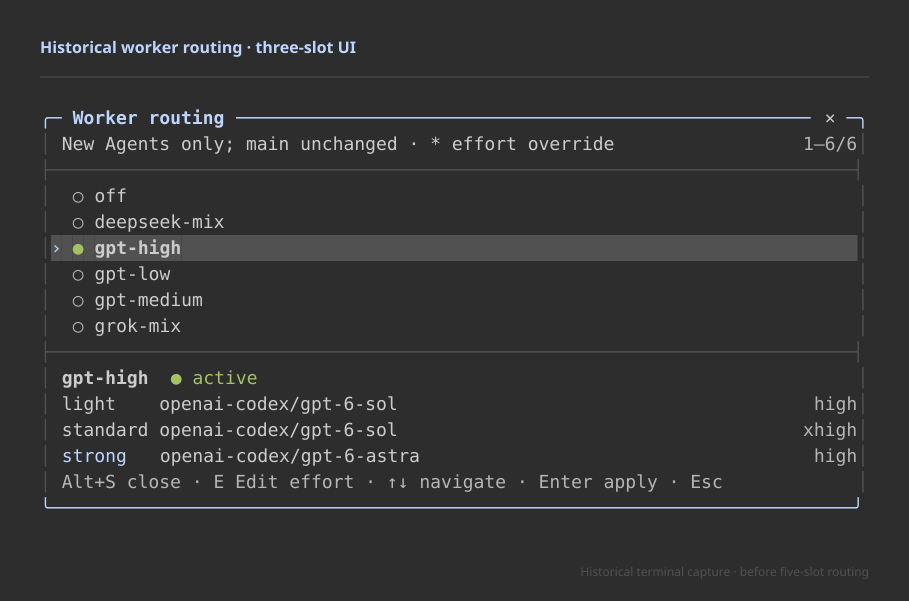
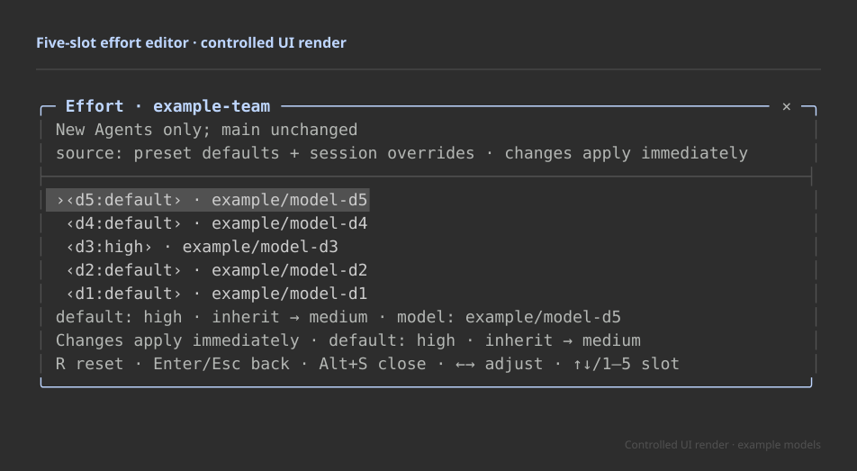
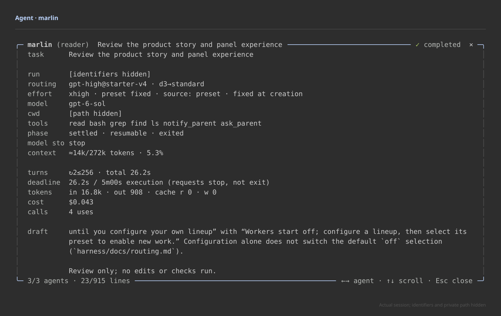
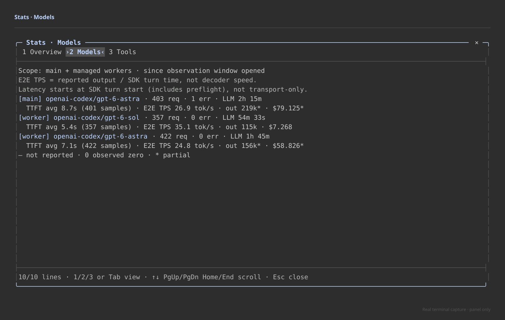

# Pi Alehouse

**One conversation. A whole crew.**

Pi Alehouse turns Pi into a multi-agent workspace. Bring in help, keep useful agents around, and see what everyone is doing—without leaving your main conversation.

The point isn't to spawn more agents. It's to make a team of them worth working with.

## Give the task a difficulty, not a model name

Your main agent assesses a task's reasoning difficulty (`reasoning_difficulty`, 1 easiest → 5 hardest). **You decide which models and how much thinking those tasks get.**

Worker presets map difficulty 1–5 one-to-one to five independently configurable slots, `d1`–`d5`, using your choice of models—even across providers. Slots can share a model; thinking effort is a separate control. A quick lookup and a difficult design decision don't have to get the same treatment, and neither has to use your main model.

Set up your lineups once; select a preset and tune its thinking effort from the panel, not a pile of prompts. New agents take the new settings; agents already working keep theirs.

The same panel sets how much your main agent hands off: **Manual**, **Co-worker**, **Lead** or **Supervisor**, and how eagerly. Each position is one short line in the main agent's prompt, and the panel shows it. In Co-worker, Lead and Supervisor the main agent's own web tools are hidden: scouts handle all web research, even small lookups, regardless of eagerness. Their cited findings are intended to reduce direct exposure to untrusted pages, not make the results trusted. Manual and Off restore the web tools' upstream selection.

*Historical capture of the author's three-slot setup, not the current UI or a suggested default.*

*Current UI renderer with example models, not a live-provider capture. Slots display d5→d1; reasoning difficulty still increases from 1 to 5.*

## Keep the teammate, not just the answer

An agent isn't a disposable task. Within your session, it keeps its conversation between assignments.

Send it a follow-up. Redirect work while it's running. Let it ask a question when something is unclear. Give follow-ups to the agent that did the earlier work, and start a fresh one for new work: a reused agent re-reads its whole conversation on every turn.

There is no mandatory research → plan → code → review ritual. Your main agent can work directly, delegate independent pieces, or return to an existing teammate. **Parallel when it helps. Continuity when it matters.**

In one session, each admitted provider runs at most four workers at once. Models of that provider share the cap; twelve workers can stay resident.

Choose a **worker** for local diagnosis, code review, design, implementation and verification: local read/edit/write, Bash/Git and builds; no web tools. No web tools is not network isolation. Choose a **scout** to gather, compare and summarize information from local files and web sources, including local-only tasks; it returns cited findings for the main agent to decide on. Scout keeps read, grep, find, ls and the four web tools, and has no Bash, edit or write. Web material is untrusted.

Worker maps to the stable internal `editor` profile; scout maps to internal `researcher`. Review-only is a task instruction, not a strict readonly worker mode. Neither profile is an OS sandbox. See [security](harness/docs/security.md).

Agents use the parent's working directory, including pending local changes. The main agent coordinates edits and Git workflow; Alehouse does not create or manage worktrees.

## See the work—not just the final summary

Parallel work shouldn't disappear behind a spinner.

The agent panel puts names, current tasks, live tool activity, context usage and reported cost together. Open an agent to follow its actual conversation: thinking, tool calls, output and streaming replies. Read back without losing the live tail, then return to the main conversation without losing what you were typing.

*Historical capture, not the current profile contract. Only its identifiers and private path are hidden.*

The rest of the interface follows the same idea:

| Panel | What it puts in your hands |
| --- | --- |
| **Agents** | Who's working, what they're doing, and who needs an answer. |
| **Delegation & effort** | How much your main agent hands off, your worker lineup and how much thinking each kind of task gets. |
| **Usage** | Reported usage across the main conversation and worker models. |
| **Stats** | Activity, waiting, model timings and tool activity—not just a token counter. |
| **Approvals** | Permission choices in the same workspace; inspection panes step aside when a decision needs your attention. |

*Reported activity from the same working session.*

These aren't separate dashboards to babysit. They belong to the conversation you're already in.

## Try it

Alehouse uses your existing Pi installation and provider setup. Start it with `pi-alehouse`; ordinary `pi` stays ordinary Pi.

**Early preview · Linux · MIT.** Available from source; not yet published to npm. Fresh setups start with workers off: configure a lineup, then select its preset to bring them in.

**[Get started](harness/docs/getting-started.md)** · [Agent tools quickstart](harness/docs/agent-tools-quickstart.md) · [Panel guide](harness/docs/interface.md) · [Configure your crew](harness/docs/routing.md) · [Support & limits](harness/docs/limitations.md)

For contributors: [development](harness/docs/development.md), [architecture](harness/docs/architecture.md), [security](harness/docs/security.md), and [validation](harness/docs/validation-evidence.md).

---

Created by **Yang Li**. [MIT license](LICENSE) · [Third-party notices](THIRD_PARTY_NOTICES.md).
