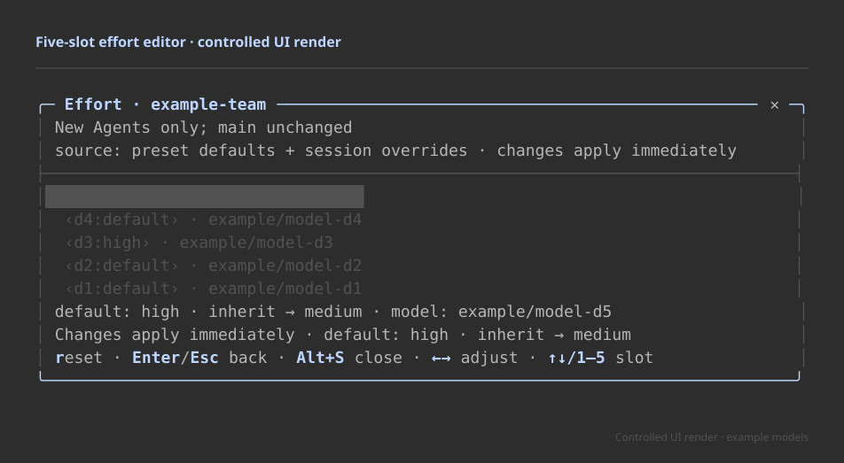
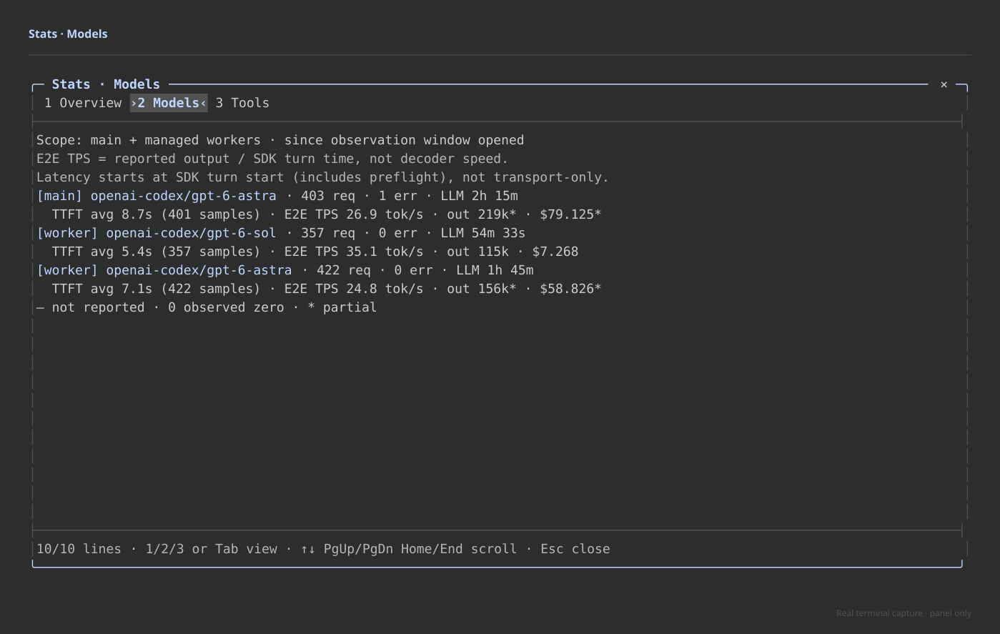

# Pi Alehouse

Pi Alehouse lets your main [Pi](https://github.com/earendil-works/pi) agent delegate work without leaving the conversation. A **worker** can investigate, edit and test locally. A **scout** can read local files and research the web. Each keeps its own conversation, so you can send a follow-up to the agent that did the work.

**[Get started](docs/getting-started.md)** · **[Documentation](docs/README.md)** · [Support and limits](docs/limitations.md)

Alehouse is a Linux source preview, not a published npm release. It uses your installed Pi and provider setup. Launch it with `pi-alehouse`; installing the npm package does not add delegation to ordinary `pi`. New installations start with workers **off**.

## Choose the team

The main agent assigns a reasoning difficulty from 1 to 5, not a model name. You choose the provider, model and thinking effort for each difficulty in a five-slot preset. Slots can share a model. Press **Alt+S** to select a preset and adjust how much to delegate. Agents already admitted keep their model and effort. In Co-worker, Lead and Supervisor modes, scouts handle web research instead of the main agent. See [routing and presets](docs/routing.md).

_Current UI renderer with example models, not a live-provider capture._

## Follow the work

Press **Alt+A** to inspect an agent's current task, tool activity and conversation. An agent can ask its parent a question, wait for an answer, or take another assignment. Use **`/stats`** to inspect activity and timings. The [panel guide](docs/interface.md) covers inspection, steering and stopping; the [agent tools quickstart](docs/agent-tools-quickstart.md) shows the corresponding model calls.

_Stats from a working session; these are observed values, not default settings._

Agents share the parent's working directory; Alehouse does not create worktrees or provide an OS sandbox. Web results remain untrusted. Cancellation is cooperative: before exiting or switching installations, use `/alehouse-close` and wait for confirmed closure. See [how sessions work](docs/orchestration.md) and [security](docs/security.md).

[MIT license](LICENSE) · [Third-party notices](THIRD_PARTY_NOTICES.md) · Created by Yang Li.
